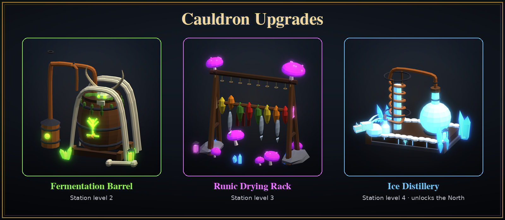
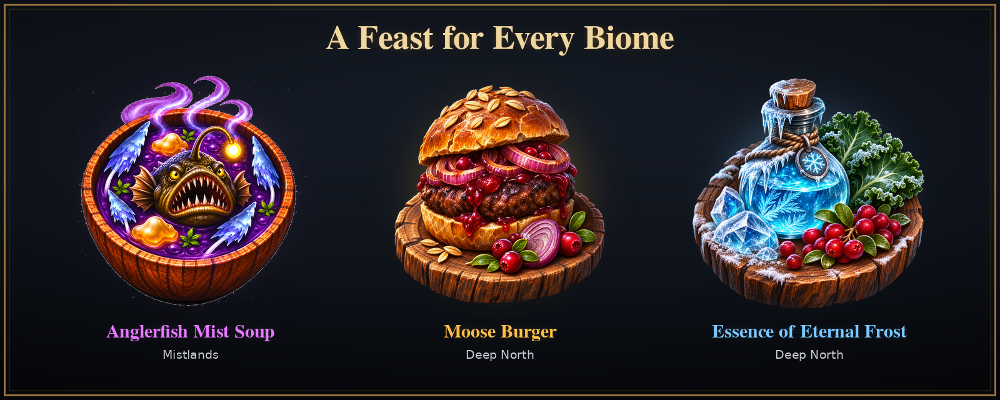

# Viking's Feast

**24 hand-crafted Viking dishes, a Runic Cauldron that grows with your journey, and three station upgrades with fully custom 3D models.**

From a simple boar herb roast in the Meadows to an Essence of Eternal Frost in the Deep North, Viking's Feast adds a full cooking progression for every biome, all cooked at the **Runic Cauldron**.

---

## 🛠️ Support

### Deutsch

Willkommen im Support-Repo von **Viking's Feast**.

1. Klicke unten auf **Bug melden** oder **Idee vorschlagen**.
2. Gib dem Ticket einen kurzen Titel, zum Beispiel `[Bug] Runenkessel kocht nicht trotz Feuer`.
3. Gib bei einem Bug die Versionen von Valheim und Viking's Feast an, dazu die Schritte, mit denen der Fehler auftritt. Sehr hilfreich ist die Datei `BepInEx/LogOutput.log`.

### English

This is the support repository for **Viking's Feast**.

1. Select **Report a bug** or **Suggest an idea** below.
2. Give the issue a short title, for example `[Bug] Runic Cauldron does not cook although the fire is burning`.
3. For a bug, include the Valheim and Viking's Feast versions and the steps to reproduce it. Your `BepInEx/LogOutput.log` helps a lot.

| Mod | Tickets / Issues | Bug melden / Report a bug | Idee vorschlagen / Suggest an idea | Changelog |
| --- | --- | --- | --- | --- |
| Viking's Feast | [Tickets ansehen / View issues](https://github.com/Pschtgasm/VikingsFeast/issues) | [Bug melden / Report a bug](https://github.com/Pschtgasm/VikingsFeast/issues/new?template=bug_report.yml) | [Idee vorschlagen / Suggest an idea](https://github.com/Pschtgasm/VikingsFeast/issues/new?template=feature_request.yml) | [CHANGELOG.md](CHANGELOG.md) |

[Viking's Feast auf Thunderstore / on Thunderstore](https://thunderstore.io/c/valheim/?q=VikingsFeast)

---

## ✨ Features

- **3 feast platters** for groups, placed with the Serving Tray
- **24 new recipes** covering Meadows, Black Forest, Swamp, Mountains, Plains, Mistlands, Ashlands and the Deep North
- **Runic Cauldron**: a new cooking station with its own 3D model, build menu icon and a **built-in fire** that works like a campfire (add wood, burns down, goes out)
- **Four visual stages**: the cauldron changes its look with every upgrade (Standard → Swamp → Mistlands → Deep North)
- **Three station upgrades**, each with its own custom model that also changes with the cauldron stage
- **Hand-painted food icons** for every dish
- **Small food effects**: 5 dishes give a mild extra effect for 10 minutes
- **Hearty Flatbread**: prepare the dough at the Runic Cauldron, then bake it in the vanilla oven
- **Fully configurable**: health, stamina, eitr, duration, regen, ingredients and portions of every dish
- **German and English** localization

---

## 🔥 The Runic Cauldron & Upgrades

Build the **Runic Cauldron** with the Hammer (Crafting tab). It has its own fire underneath: look at the logs and press **E** to add wood. The cauldron only cooks while the fire is burning. While you cook, steam rises from the cauldron in the colour of its stage. You can switch the built-in fire off in the config to use a separate campfire like in vanilla. Place the upgrades near the cauldron (up to 10 m away, configurable) to raise its station level and unlock stronger dishes.

| Upgrade | Station level | Materials |
|---|---|---|
| **Fermentation Barrel** | 2 | Fine wood, Iron, Ancient bark |
| **Runic Drying Rack** | 3 | Yggdrasil wood, Black metal, Black marble |
| **Ice Distillery** | 4 · unlocks the dishes of the North | Crystal ×20, Dragon tear ×5, Black metal scrap ×10, Yggdrasil wood ×2 *(configurable)* |

---

## 🍲 Recipes

Every dish makes **two portions** by default.

### 🌿 Meadows & Black Forest
| Dish | ❤️ Health | ⚡ Stamina | 🔮 Eitr | Lvl | Ingredients |
|---|:-:|:-:|:-:|:-:|---|
| Boar Herb Roast | 36 | 13 | – | 1 | Boar trophy 1, Dandelion 5, Honey 3 |
| Forest Berry Mash | 12 | 40 | – | 1 | Raspberries 8, Dandelion 4, Honey 3 |
| Yellow Mushroom Soup | 15 | 48 | – | 1 | Yellow mushroom 8, Carrot 4, Blueberries 4 |
| Grilled Herb Fish | 38 | 15 | – | 1 | Raw fish 2, Dandelion 3, Honey 2 |
| Forest Mushroom Fish Pan | 42 | 20 | – | 1 | Raw fish 2, Yellow mushroom 4, Thistle 3 |

### 🐸 Swamp
| Dish | ❤️ Health | ⚡ Stamina | 🔮 Eitr | Lvl | Ingredients |
|---|:-:|:-:|:-:|:-:|---|
| Draugr Meat Stew | 66 | 20 | – | 2 | Entrails 5, Turnip 4, Thistle 5 |
| Blood Seaweed Stew | 64 | 22 | – | 2 | Bloodbag 4, Entrails 4, Thistle 5 |
| Swamp Fish Stew | 22 | 60 | – | 2 | Trollfish 2, Thistle 4, Turnip 3 |

### 🏔️ Mountains
| Dish | ❤️ Health | ⚡ Stamina | 🔮 Eitr | Lvl | Ingredients |
|---|:-:|:-:|:-:|:-:|---|
| Wolf Herb Roast | 68 | 22 | – | 2 | Wolf trophy 1, Wolf meat 4, Onion 4 |
| Dragon Broth | 24 | 70 | – | 2 | Powdered dragon eggshells 2, Onion 4, Freeze gland 2 |
| Frost Fish Roast | 71 | 24 | – | 2 | Northern salmon 2, Onion 4, Freeze gland 2 |

### 🌾 Plains
| Dish | ❤️ Health | ⚡ Stamina | 🔮 Eitr | Lvl | Ingredients |
|---|:-:|:-:|:-:|:-:|---|
| Golden Barley Porridge | 25 | 78 | – | 2 | Barley flour 8, Cloudberries 6, Honey 4 |
| Pufferfish Barley Pan | 82 | 28 | – | 2 | Pufferfish 2, Barley flour 5, Cloudberries 4 |
| Hearty Flatbread | 35 | 70 | – | 2 | Dough: Barley flour 10, Onion 3, Lox meat 2 → bake in the oven |

### 🍄 Mistlands
| Dish | ❤️ Health | ⚡ Stamina | 🔮 Eitr | Lvl | Ingredients |
|---|:-:|:-:|:-:|:-:|---|
| Magic Mushroom Cream | 28 | 88 | – | 3 | Magecap 6, Jotun puffs 6, Royal jelly 4 |
| Anglerfish Mist Soup | 32 | 99 | – | 3 | Anglerfish 2, Magecap 5, Royal jelly 3 |
| Royal Mist Ragout | 30 | 15 | 85 | 2 | Royal jelly 4, Magecap 5, Hare meat 3 |
| Tick Broth | 70 | 24 | – | 3 | Bloodbag 4, Woodland herb blend 2, Sap 2 |

### 🌋 Ashlands
| Dish | ❤️ Health | ⚡ Stamina | 🔮 Eitr | Lvl | Ingredients |
|---|:-:|:-:|:-:|:-:|---|
| Volcanic Vulture Roast | 100 | 32 | – | 3 | Volture meat 4, Vineberry cluster 6, Smoke puff 4 |
| Ember Herb Soup | 32 | 96 | – | 3 | Vineberry cluster 7, Smoke puff 6, Magecap 4 |
| Asksvin Ember Feast | 38 | 20 | 100 | 3 | Celestial feather 3, Proustite powder 5, Asksvin meat 4 |

### ❄️ Deep North *(requires the Ice Distillery)*
| Dish | ❤️ Health | ⚡ Stamina | 🔮 Eitr | Lvl | Ingredients |
|---|:-:|:-:|:-:|:-:|---|
| Essence of Eternal Frost | 38 | 20 | 110 | 4 | Liquid frost 6, Kale 2, Lingonberries 5 |
| Moose Burger | 110 | 35 | – | 4 | Moose meat 2, Barley flour 4, Onion 2, Lingonberries 3 |
| Northern Lights Oat Porridge | 35 | 112 | – | 4 | Oats 8, Lingonberries 5, Oat milk 4, Poteitr 3 |
### 🍖 Feast platters
Made at the **Food Preparation Table** (or the Runic Cauldron, see config) and placed with the vanilla **Serving Tray**. Everyone at the table can eat: 10 servings, 50 minutes each. Unlike the balanced vanilla feasts, each platter has a focus: Bog Feast health, Golden Harvest Table stamina, Northern Lights Banquet eitr. They look like the vanilla feasts, slightly tinted: greenish, golden and frosty blue.

| Feast | ❤️ Health | ⚡ Stamina | 🔮 Eitr | Regen | Ingredients |
|---|:-:|:-:|:-:|:-:|---|
| Bog Feast | 40 | 30 | – | 3 | Draugr meat stew 4, Swamp fish stew 2, Bloodbag 4, Woodland herb blend 1 |
| Golden Harvest Table | 50 | 60 | – | 4 | Hearty flatbread 3, Pufferfish barley pan 2, Cloudberries 5, Grasslands herbalist harvest 1 |
| Northern Lights Banquet | 70 | 60 | 80 | 7 | Moose burger 3, Northern lights oat porridge 2, Lingonberries 5, Seasoning of the gourd 1 |

### ✨ Dishes with a small extra effect (10 min)
| Dish | Effect |
|---|---|
| Blood Seaweed Stew | Slightly less poison damage (−25 %) |
| Frost Fish Roast | Slightly less frost damage (−25 %) |
| Anglerfish Mist Soup | Eitr regeneration +10 % |
| Ember Herb Soup | Slightly less fire damage (−25 %) |
| Northern Lights Oat Porridge | Stamina regeneration +10 % |

The effects are intentionally weaker than vanilla resistance meads and can be switched off in the config.

**Lvl** = required Runic Cauldron station level (1 = cauldron only, 2 = + Fermentation Barrel, 3 = + Runic Drying Rack, 4 = + Ice Distillery). Duration is 20 / 25 / 30 min for station level 1 / 2 / 3–4 unless set otherwise; health regen follows the matching vanilla dish. The main stat of every dish is 80-110 % of the best vanilla food of the same biome. All values can be changed in the config.

> All ingredient IDs are checked against Valheim 1.0. If an ingredient prefab is missing (e.g. after a game update), only that dish is skipped and a warning is written to the log.

---

## ⚙️ Configuration

`BepInEx/config/de.vikingfoodplus.mod.cfg`

- Enable or disable the whole mod or individual dishes
- Health, stamina, eitr, duration and regen per dish
- Ingredients (`Prefab:count`, comma-separated) and portions
- Build cost of the Ice Distillery (`Piece - IceDistillery > Requirements`)
- Size of the upgrades (`Piece - Extensions > Scale`, default `0.75`) and how far from the cauldron they still count (`MaxDistance`, default `10` m)
- Feast platters on/off (`Feasts > Enabled`) and where they are made (`Feasts > Station`: `PrepTable` (default) or `RuneCauldron`)
- Small food effects on/off (`General > FoodBuffs`, default `true`)
- Cooking time at the Runic Cauldron (`Piece - RuneCauldron > CookTime`, default `0` = vanilla)
- Built-in cauldron fire on/off (`Piece - RuneCauldron > IntegratedFire`, default `true`), its height (`FireHeightOffset`) and its smoke (`FireSmoke`)

A game restart is required after changes. On servers, everyone should use the same config.

> **Updating from an older version?** Nothing to do: since 1.4.2 dish settings are stored under `[Dish - <ID>]`, so the new defaults are applied automatically. Old `[Food - …]` sections are ignored and can be deleted from the config file.

---

## 📦 Installation

**Recommended:** Install with **r2modman** or the **Thunderstore Mod Manager**. Dependencies are installed automatically.

**Manual:**
1. Install [BepInExPack Valheim](https://thunderstore.io/c/valheim/p/denikson/BepInExPack_Valheim/)
2. Install [Jötunn](https://thunderstore.io/c/valheim/p/ValheimModding/Jotunn/)
3. Copy `VikingFoodPlus.dll` to `BepInEx/plugins/VikingsFeast/`

Multiplayer: install the mod on **all clients and the server**.

---

## 🇩🇪 Deutsch

**Viking's Feast** bringt 24 neue Wikinger-Gerichte für jedes Biom, von der Wiese bis zum Hohen Norden. Gekocht wird am **Runenkessel** mit eingebautem Feuer (Holz nachlegen wie beim Lagerfeuer, in der Config abschaltbar), der mit jeder Erweiterung sein Aussehen ändert (Standard → Sumpf → Nebelland → Hoher Norden).

- **Gärfass** → Kochstufe 2
- **Runen-Trockengestell** → Kochstufe 3
- **Eisdestillerie** → Kochstufe 4, schaltet die Gerichte des Nordens frei

Dazu kommen drei Festmahl-Platten für Gruppen (Moorschmaus, Goldene Erntetafel, Nordlicht-Festtafel), die man mit dem Servierbrett aufstellt. Fünf Gerichte geben zusätzlich einen kleinen Effekt für 10 Minuten, etwa etwas Frost- oder Feuerschutz. Alle Bauteile haben eigene 3D-Modelle, jedes Gericht ein eigenes Icon. Werte, Zutaten und Portionen lassen sich in der Config anpassen. Das Spiel ist komplett auf Deutsch und Englisch übersetzt.

---

## 📝 Changelog

See [CHANGELOG.md](CHANGELOG.md).

## 💬 Feedback & Bugs

Found a bug or have an idea for a new dish? See **Support** at the top: [report a bug](https://github.com/Pschtgasm/VikingsFeast/issues/new?template=bug_report.yml) or [suggest an idea](https://github.com/Pschtgasm/VikingsFeast/issues/new?template=feature_request.yml).
