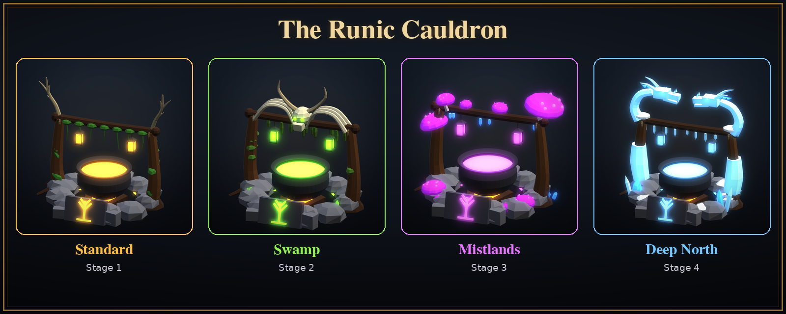
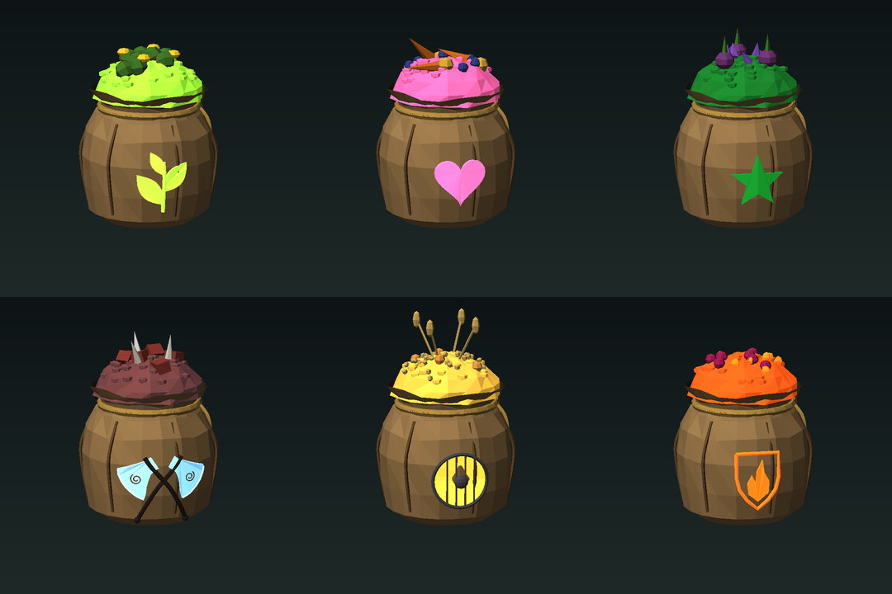
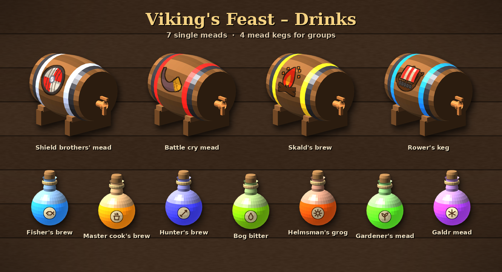

# Viking's Feast

**24 hand-crafted Viking dishes, 11 meads, 6 animal feeds, a Runic Cauldron that grows with your journey, and three station upgrades with fully custom 3D models.**

From a simple boar herb roast in the Meadows to an Essence of Eternal Frost in the Deep North, Viking's Feast adds a full cooking progression for every biome, all cooked at the **Runic Cauldron**. Brew meads with small, useful effects Valheim does not have, share mead kegs with your crew, and cook feed that helps you tame, breed and strengthen your animals.

---

## 🛠️ Support

### Deutsch

Willkommen im Support-Repo von **Viking's Feast**.

1. Klicke unten auf **Bug melden** oder **Idee vorschlagen**.
2. Gib dem Ticket einen kurzen Titel, zum Beispiel `[Bug] Runenkessel kocht nicht trotz Feuer`.
3. Gib bei einem Bug die Versionen von Valheim und Viking's Feast an, dazu die Schritte, mit denen der Fehler auftritt. Sehr hilfreich ist die Datei `BepInEx/LogOutput.log`.

### English

This is the support repository for **Viking's Feast**.

1. Select **Report a bug** or **Suggest an idea** below.
2. Give the issue a short title, for example `[Bug] Runic Cauldron does not cook although the fire is burning`.
3. For a bug, include the Valheim and Viking's Feast versions and the steps to reproduce it. Your `BepInEx/LogOutput.log` helps a lot.

| Mod | Tickets / Issues | Bug melden / Report a bug | Idee vorschlagen / Suggest an idea | Changelog |
| --- | --- | --- | --- | --- |
| Viking's Feast | [Tickets ansehen / View issues](https://github.com/Pschtgasm/VikingsFeast/issues) | [Bug melden / Report a bug](https://github.com/Pschtgasm/VikingsFeast/issues/new?template=bug_report.yml) | [Idee vorschlagen / Suggest an idea](https://github.com/Pschtgasm/VikingsFeast/issues/new?template=feature_request.yml) | [CHANGELOG.md](https://github.com/Pschtgasm/VikingsFeast/blob/main/CHANGELOG.md) |

[Viking's Feast auf Thunderstore / on Thunderstore](https://thunderstore.io/c/valheim/p/Pscht/VikingsFeast/)

---

## ✨ Features

- **24 new recipes** plus **3 seasonal dishes** for Valheim's Midsummer, Halloween and Yule events, covering Meadows, Black Forest, Swamp, Mountains, Plains, Mistlands, Ashlands and the Deep North
- **6 animal feeds** *(new in 1.7.0)*: one per biome for boar, wolf, lox, asksvin and hen. Tame faster, breed faster, get offspring with an extra star or make your animals stronger. Fed animals glow in the colour of their feed
- **7 secret recipes** *(new in 1.6.0)*: one per biome, learned from recipe scrolls found in chests or bought from traders, each with its own special effect
- **11 drinks** *(new in 1.5.0)*: 7 single meads and 4 mead kegs for groups, each with a small effect Valheim does not have
- **3 feast platters** for groups, placed with the Serving Tray
- **Runic Cauldron**: a new cooking station with its own 3D model and a **built-in fire** that always burns, no wood needed (can be switched to campfire behaviour)
- **Four visual stages**: the cauldron changes its look with every upgrade (Standard → Swamp → Mistlands → Deep North), each with its own glowing sign: boar head, dead tree, Seeker, snowflake
- **Three station upgrades**, each with its own custom model that also changes with the cauldron stage
- **Fermentation Barrel** brews mead too: no roof needed, shows its state and the remaining time
- **Tidy cooking menu**: at the Runic Cauldron the recipes are split into the collapsible groups **Food**, **Secret recipes**, **Animal feed** and **Mead**. Three potions at the top right sort the dishes by health, stamina or eitr (also at other stations if you like, see config)
- **Valheim-style icons** for every dish, drink and station
- **Small food effects**: 5 dishes give a mild extra effect for 10 minutes
- **Hearty Flatbread**: prepare the dough at the Runic Cauldron, then bake it in the vanilla oven
- **Fully configurable**: values, ingredients, portions, effects, stations and much more
- **German and English** localization, with a config option to choose the language of the mod texts *(new in 1.6.1)*

---

## 🔥 The Runic Cauldron & Upgrades

Build the **Runic Cauldron** with the Hammer (Crafting tab). It has its own fire underneath that always stays full, so you never need to add wood. With `CauldronFireInfinite = false` it burns down like a campfire and you add wood with **E**. While you cook, steam rises from the cauldron in the colour of its stage. You can switch the built-in fire off in the config to use a separate campfire like in vanilla, or cook the dishes at the vanilla Cauldron instead (`CookingStation`). Place the upgrades near the cauldron (up to 10 m away, configurable) to raise its station level and unlock stronger dishes.

| Upgrade | Station level | Materials |
|---|---|---|
| **Fermentation Barrel** | 2 · also ferments mead | Fine wood, Iron, Ancient bark |
| **Runic Drying Rack** | 3 | Yggdrasil wood, Black metal, Black marble |
| **Ice Distillery** | 4 · unlocks the dishes of the North | Crystal ×20, Dragon tear ×5, Black metal scrap ×10, Yggdrasil wood ×2 *(configurable)* |

---

## 🍲 Recipes

📊 **Sortable recipe sheet** with all dishes, drinks and feeds plus a list of every ingredient: [Recipe sheet](https://claude.ai/artifact/HViqJptevjZptkcLeBPn3C)

Every dish makes **two portions** by default.

### 🌿 Meadows & Black Forest
| Dish | ❤️ Health | ⚡ Stamina | 🔮 Eitr | Lvl | Ingredients |
|---|:-:|:-:|:-:|:-:|---|
| Boar Herb Roast | 36 | 13 | – | 1 | Boar trophy 1, Dandelion 5, Honey 3 |
| Forest Berry Mash | 12 | 40 | – | 1 | Raspberries 8, Dandelion 4, Honey 3 |
| Yellow Mushroom Soup | 15 | 48 | – | 1 | Yellow mushroom 8, Carrot 4, Blueberries 4 |
| Grilled Herb Fish | 38 | 15 | – | 1 | Raw fish 2, Dandelion 3, Honey 2 |
| Forest Mushroom Fish Pan | 42 | 20 | – | 1 | Raw fish 2, Yellow mushroom 4, Thistle 3 |

### 🐸 Swamp
| Dish | ❤️ Health | ⚡ Stamina | 🔮 Eitr | Lvl | Ingredients |
|---|:-:|:-:|:-:|:-:|---|
| Draugr Meat Stew | 66 | 20 | – | 2 | Entrails 5, Turnip 4, Thistle 5 |
| Blood Seaweed Stew | 64 | 22 | – | 2 | Bloodbag 4, Entrails 4, Thistle 5 |
| Swamp Fish Stew | 22 | 60 | – | 2 | Trollfish 2, Thistle 4, Turnip 3 |

### 🏔️ Mountains
| Dish | ❤️ Health | ⚡ Stamina | 🔮 Eitr | Lvl | Ingredients |
|---|:-:|:-:|:-:|:-:|---|
| Wolf Herb Roast | 68 | 22 | – | 2 | Wolf trophy 1, Wolf meat 4, Onion 4 |
| Dragon Broth | 24 | 70 | – | 2 | Powdered dragon eggshells 2, Onion 4, Freeze gland 2 |
| Frost Fish Roast | 71 | 24 | – | 2 | Northern salmon 2, Onion 4, Freeze gland 2 |

### 🌾 Plains
| Dish | ❤️ Health | ⚡ Stamina | 🔮 Eitr | Lvl | Ingredients |
|---|:-:|:-:|:-:|:-:|---|
| Golden Barley Porridge | 25 | 78 | – | 2 | Barley flour 8, Cloudberries 6, Honey 4 |
| Pufferfish Barley Pan | 82 | 28 | – | 2 | Pufferfish 2, Barley flour 5, Cloudberries 4 |
| Hearty Flatbread | 35 | 70 | – | 2 | Dough: Barley flour 10, Onion 3, Lox meat 2 → bake in the oven |

### 🍄 Mistlands
| Dish | ❤️ Health | ⚡ Stamina | 🔮 Eitr | Lvl | Ingredients |
|---|:-:|:-:|:-:|:-:|---|
| Magic Mushroom Cream | 28 | 88 | – | 3 | Magecap 6, Jotun puffs 6, Royal jelly 4 |
| Anglerfish Mist Soup | 32 | 99 | – | 3 | Anglerfish 2, Magecap 5, Royal jelly 3 |
| Royal Mist Ragout | 30 | 15 | 85 | 2 | Royal jelly 4, Magecap 5, Hare meat 3 |
| Tick Broth | 70 | 24 | – | 3 | Bloodbag 4, Woodland herb blend 2, Sap 2 |

### 🌋 Ashlands
| Dish | ❤️ Health | ⚡ Stamina | 🔮 Eitr | Lvl | Ingredients |
|---|:-:|:-:|:-:|:-:|---|
| Volcanic Vulture Roast | 100 | 32 | – | 3 | Volture meat 4, Vineberry cluster 6, Smoke puff 4 |
| Ember Herb Soup | 32 | 96 | – | 3 | Vineberry cluster 7, Smoke puff 6, Magecap 4 |
| Asksvin Ember Feast | 38 | 20 | 100 | 3 | Celestial feather 3, Proustite powder 5, Asksvin meat 4 |

### ❄️ Deep North *(requires the Ice Distillery)*
| Dish | ❤️ Health | ⚡ Stamina | 🔮 Eitr | Lvl | Ingredients |
|---|:-:|:-:|:-:|:-:|---|
| Essence of Eternal Frost | 38 | 20 | 110 | 4 | Liquid frost 6, Kale 2, Lingonberries 5 |
| Moose Burger | 110 | 35 | – | 4 | Moose meat 2, Barley flour 4, Onion 2, Lingonberries 3 |
| Northern Lights Oat Porridge | 35 | 112 | – | 4 | Oats 8, Lingonberries 5, Oat milk 4, Poteitr 3 |

### 🎉 Seasonal *(only during Valheim's Midsummer, Halloween and Yule events)*
| Dish | ❤️ Health | ⚡ Stamina | 🔮 Eitr | Lvl | Ingredients |
|---|:-:|:-:|:-:|:-:|---|
| Midsummer Berry Cake | 14 | 45 | – | 1 | Raspberries 6, Blueberries 6, Honey 4, Dandelion 3 |
| Grinning Turnip Broth | 18 | 54 | – | 2 | Turnip 4, Ooze 2, Yellow mushroom 2, Woodland herb blend 1 |
| Yule Roast | 45 | 14 | – | 1 | Deer meat 3, Raspberries 4, Honey 2, Carrot 2 |

The seasonal dishes appear at the Runic Cauldron together with Valheim's own seasonal content and disappear again when the event ends. Dishes you have already cooked stay edible. With `[Seasonal] AlwaysAvailable = true` they can be cooked all year.

### 🍖 Feast platters
Made at the **Food Preparation Table** (or the Runic Cauldron, see config) and placed with the vanilla **Serving Tray**. Everyone at the table can eat: 10 servings, 50 minutes each. Unlike the balanced vanilla feasts, each platter has a focus: Bog Feast health, Golden Harvest Table stamina, Northern Lights Banquet eitr.

| Feast | ❤️ Health | ⚡ Stamina | 🔮 Eitr | Regen | Ingredients |
|---|:-:|:-:|:-:|:-:|---|
| Bog Feast | 40 | 30 | – | 3 | Draugr meat stew 4, Swamp fish stew 2, Bloodbag 4, Woodland herb blend 1 |
| Golden Harvest Table | 50 | 60 | – | 4 | Hearty flatbread 3, Pufferfish barley pan 2, Cloudberries 5, Grasslands herbalist harvest 1 |
| Northern Lights Banquet | 70 | 60 | 80 | 7 | Moose burger 3, Northern lights oat porridge 2, Lingonberries 5, Seasoning of the gourd 1 |

### ✨ Dishes with a small extra effect (10 min)
| Dish | Effect |
|---|---|
| Blood Seaweed Stew | Slightly less poison damage (−25 %) |
| Frost Fish Roast | Slightly less frost damage (−25 %) |
| Anglerfish Mist Soup | Eitr regeneration +10 % |
| Ember Herb Soup | Slightly less fire damage (−25 %) |
| Northern Lights Oat Porridge | Stamina regeneration +10 % |
| Midsummer Berry Cake 🎉 | Stamina regeneration +10 % |
| Grinning Turnip Broth 🎉 | Health regeneration +10 % |
| Yule Roast 🎉 | Slightly less frost damage (−25 %) |

The effects are intentionally weaker than vanilla resistance meads and can be switched off in the config.

**Lvl** = required Runic Cauldron station level (1 = cauldron only, 2 = + Fermentation Barrel, 3 = + Runic Drying Rack, 4 = + Ice Distillery). Duration is 20 / 25 / 30 min for station level 1 / 2 / 3–4 unless set otherwise; health regen follows the matching vanilla dish. The main stat of every dish is 80-110 % of the best vanilla food of the same biome. All values can be changed in the config.

---

## 🐗 Animal feed *(new in 1.7.0)*

Six feeds for **boar, wolf, lox, asksvin and hen**, cooked at the Runic Cauldron (group **Animal feed**). Each feed comes in its own sack with a symbol and lasts **30 minutes**. Fed animals **glow** in the colour of their feed, and their hover text shows each active feed with its remaining time.

| Biome | Feed | Level | Ingredients | Effect | Glow |
|---|---|:-:|---|---|---|
| 🌿 Meadows | Taming herb | 1 | Dandelion 4, Raspberries 4, Honey 1 | Wild animals tame **twice as fast**, stay calm and don't attack (hitting them cancels this for 10 s) | light green |
| 🌲 Black Forest | Freya's lure | 1 | Blueberries 4, Carrot 3, Yellow mushroom 2 | Faster breeding: pregnancy chance ×2, pregnancy time ÷2 | pink |
| 🐸 Swamp | Norns' blessing | 2 | Turnip 3, Thistle 3, Guck 1 | **25 %** chance that an offspring is born with **one more star** (up to 2 stars) | dark green |
| 🏔️ Mountains | Fenrir's bite | 2 | Wolf meat 2, Onion 1, Fenris claw 1 | **+25 %** damage | icy blue |
| 🌾 Plains | Armor grain | 2 | Barley 6, Flax 3, Cloudberries 3 | **25 %** less damage taken | golden |
| 🌋 Ashlands | Ember shell | 3 | Vineberries 4, Smoke puffs 3, Proustite powder 1 | Fire damage **halved**, heals 2 % health every 5 s | orange |

**How to feed:** look at the animal and press the hotbar key, or drop the feed on the ground. Hungry animals walk to it, fed animals eat it when they stand right next to it. Feed also counts as a meal (taming and breeding).
**At most 2 feeds** per animal: a third one replaces the oldest, the same feed again restarts its time. With two feeds the glow alternates between both colours. Works in multiplayer, feeds are stored on the animal. Feed sacks can also be placed on item stands.

---

## 📜 Secret recipes *(new in 1.6.0)*

One special dish per biome from the Black Forest to the Deep North. You can only cook them after learning the recipe from a **recipe scroll** (right-click the scroll). Scrolls are hidden in chests, and Haldor sells each scroll once you have defeated the boss of its biome. Each dish has its own effect for 10 minutes.

| Biome | Dish | ❤️ | ⚡ | 🔮 | Effect (10 min) | Scroll found in |
|---|---|:-:|:-:|:-:|---|---|
| 🌲 Black Forest | Stuffed grave shroom | 44 | 16 | – | Sneaking costs 25% less stamina | Burial chambers, troll caves |
| 🐸 Swamp | Bog witch blood sausage | 54 | 19 | – | +10% damage against undead | Sunken crypts |
| 🏔️ Mountains | Frost wolf roulade | 22 | 64 | – | 50% less fall damage | Frost caves |
| 🌾 Plains | Fuling fried egg | 50 | 50 | – | Blocking costs 15% less stamina | Fuling villages |
| 🍄 Mistlands | Dvergr mushroom loaf | 30 | 22 | 75 | Sprinting costs 15% less stamina | Dvergr ruins, infested mines |
| 🌋 Ashlands | Sulphur skewer | 104 | 36 | – | Dodge rolls cost 20% less stamina | Ashlands fortresses |
| ❄️ Deep North | Ymir's pancake tower | 40 | 88 | 32 | You stagger 25% less | Chests in the Deep North |

No secret dish is stronger in total than the best Valheim food of its biome; the special effect is the reward. At the Runic Cauldron they have their own group **Secret recipes (x/7)**. Recipes you have not learned yet appear as **???**; click one to see where its scroll can be found, without revealing the dish.

---

## 🍺 Drinks *(new in 1.5.0)*

Small meads with useful effects that Valheim does not have. They don't take a food slot and are meant to complement the vanilla meads, not replace them. **At most 2 drinks** can be active at the same time; drinking a third ends the oldest.

### Single meads
Make the mead base at the vanilla **Mead Ketill**, ferment it in the vanilla **Fermenter** or in the **Fermentation Barrel**. One base gives **6 bottles**, each lasting **10 minutes**.

| Mead | Ingredients (base) | Effect |
|---|---|---|
| Fisher's brew | Honey 10, Raw fish 3, Fishing bait 10, Dandelion 5 | Fish bite more readily |
| Master cook's brew | Honey 10, Yellow mushroom 6, Carrot 6, Thistle 4 | Eaten food lasts 10 % longer |
| Hunter's brew | Honey 10, Blueberries 10, Raw meat 3, Feathers 5 | Bows and crossbows draw 10 % faster |
| Bog bitter | Honey 10, Thistle 6, Turnip 6, Guck 4 | No wet effect |
| Helmsman's grog | Honey 10, Serpent scale 3, Onion 8, Resin 6 | Side wind drives the ship 20 % better (when steering) |
| Gardener's mead | Honey 10, Carrot 5, Turnip 5, Barley 8 | 20 % chance of an extra yield when harvesting and picking |
| Galdr mead | Honey 10, Sap 6, Magecap 6, Royal jelly 4 | Spells cost 10 % less eitr |

Every single mead has its own bottle in its colour, also on the ground and on item stands.

### Mead kegs for groups
Make the keg base at the **Runic Cauldron** (station level 2), ferment it in the **Fermentation Barrel** and place the keg with the **Serving Tray**. A keg has **10 servings** for everyone, each lasting **20 minutes**.

| Keg | Ingredients (base) | Effect |
|---|---|---|
| Shield brothers' mead | Honey 20, Onion 10, Wolf meat 8, Wolf trophy 2 | −5 % damage taken while a fellow player is nearby |
| Battle cry mead | Honey 20, Bloodbag 8, Cloudberries 10, Fuling trophy 1 | +5 % damage while a fellow player is nearby |
| Skald's brew | Honey 20, Cloudberries 15, Barley 15, Lox trophy 1 | Skills rise 10 % faster |
| Rower's keg | Honey 20, Serpent meat 4, Barley 12, Resin 8 | +3 % sailing speed per player on board (max +12 %) |

**Feast bonus:** kegs are a bit stronger with 3 or more players nearby. **Rest bonus:** you get rested faster after drinking from a keg.

### Fermentation Barrel
Ferments mead like the vanilla Fermenter, but **without a roof**. You can see what's going on: foam while it ferments, mead dripping from the tap when it's ready, and the **remaining time** when you look at it.

---

## ⚙️ Configuration

`BepInEx/config/de.vikingfoodplus.mod.cfg` – sorted from general to specific:

**1 - General**
- Mod on/off (`Enabled`)
- Language of the mod texts (`Language`): `Auto` (default: German for a German game, English for every other language), `English` or `German`. Each player sets this in their own config
- Where the dishes are cooked (`CookingStation`): `RuneCauldron` (default), `Cauldron` (vanilla cauldron) or `Both`
- Recipe groups at the Runic Cauldron (`RecipeGroups`, default on) and sort buttons (`SortButtons`: `RuneCauldron` (default), `Cooking`, `All` or `Off`)
- Built-in cauldron fire (`CauldronFire`, default on), whether it always stays full (`CauldronFireInfinite`, default on), its height (`CauldronFireHeight`) and smoke (`CauldronFireSmoke`), cooking time (`CookTime`, `0` = vanilla)
- Build cost of the Ice Distillery (`IceDistilleryCost`)

**2 - Food**
- Small food effects (`FoodBuffs`, default on)
- Feast platters on/off (`Feasts`) and where they are made (`FeastStation`: `PrepTable` (default) or `RuneCauldron`)

**3 - Drinks**
- Drinks on/off (`Enabled`)
- Stations for single meads: Mead Ketill (`SinglesAtMeadKetill`, default on), Runic Cauldron (`SinglesAtRuneCauldron`), vanilla Fermenter (`SinglesInVanillaFermenter`, default on)
- Fermentation time of the barrel (`FermentTime`, default `2400` s = like the vanilla Fermenter) and remaining time display (`ShowFermentTime`, default on)
- Max. drinks at the same time (`MaxActive`, default `2`), feast bonus (`GroupBonus`), rest bonus (`RestBonus`), Rower's keg maximum (`RowerMaxBonus`)

**4 - Secret Recipes**
- On/off (`Enabled`), scrolls needed (`NeedScroll`, default on; off = they unlock like normal recipes)
- Chance for a scroll in a matching chest (`ScrollChance`, default `0.12` = 12%; each chest rolls once, when it is opened for the first time) and price at Haldor (`ScrollPrice`, default `250`)
- `LogChests`: writes the name of every chest you open for the first time and its scroll roll to the log

**5 - Seasonal**
- Seasonal dishes on/off (`Enabled`) and all year (`AlwaysAvailable`, default on)

**6 - Animal Feed**
- Animal feed on/off (`Enabled`), glow on/off (`Glow`, takes effect immediately), duration (`Duration`, default `1800` s)
- Effect strength: `TamingSpeed`, `TamingCalm`, `BreedingSpeed`, `StarChance`, `MaxStars`, `DamageBonus`, `DamageReduction`, `FireReduction`, `HealPercent`

**Single dishes and drinks** (at the end of the file)
- `Dish - <ID>`: on/off, health, stamina, eitr, duration, regen, ingredients (`Prefab:count`), portions
- `Drink - <ID>`: on/off, ingredients, effect strength, duration
- `Secret - <ID>`: on/off, values, ingredients, portions, chests (`LootChests`), trader (`SoldBy`) and boss key (`SoldAfterBoss`)
- `Feed - <ID>`: on/off, ingredients, portions

A game restart is required after most changes. On servers, everyone should use the same config.

> **Updating from 1.5.x?** The general settings moved to the numbered sections above, so they start with their default values once. Your settings for single dishes and drinks (`Dish - …`, `Drink - …`) are kept. Old sections like `[General]`, `[Drinks]`, `[Feasts]`, `[Seasonal]` or `[Piece - …]` are ignored and can be deleted.

> All ingredient IDs are checked against Valheim 1.0. If an ingredient prefab is missing (e.g. after a game update), only that ingredient is skipped and a warning is written to the log.

---

## 📦 Installation

**Recommended:** Install with **r2modman** or the **Thunderstore Mod Manager**. Dependencies are installed automatically.

**Manual:**
1. Install [BepInExPack Valheim](https://thunderstore.io/c/valheim/p/denikson/BepInExPack_Valheim/)
2. Install [Jötunn](https://thunderstore.io/c/valheim/p/ValheimModding/Jotunn/)
3. Copy `VikingFoodPlus.dll` to `BepInEx/plugins/VikingsFeast/`

Multiplayer: install the mod on **all clients and the server**.

---

## 🇩🇪 Deutsch

**Viking's Feast** bringt 24 neue Wikinger-Gerichte für jedes Biom, von der Wiese bis zum Hohen Norden, dazu Met, Geheimrezepte und Tierfutter. Gekocht wird am **Runenkessel** mit eingebautem Feuer (Holz nachlegen wie beim Lagerfeuer, in der Config abschaltbar), der mit jeder Erweiterung sein Aussehen und sein Leuchtzeichen ändert (Standard → Sumpf → Nebelland → Hoher Norden).

- **Gärfass** → Kochstufe 2, gärt außerdem Met (auch ohne Dach, mit Restzeit-Anzeige)
- **Runen-Trockengestell** → Kochstufe 3
- **Eisdestillerie** → Kochstufe 4, schaltet die Gerichte des Nordens frei

**Neu in 1.7.0: Tierfutter.** 6 Futter am Runenkessel (Gruppe **Tierfutter**) für Eber, Wolf, Lox, Asksvin und Huhn, eins pro Biom: **Zähmkraut** (doppelt so schnell zahm, Tiere bleiben ruhig), **Freyas Lockfutter** (schnellere Paarung), **Nornensegen** (25 % Chance auf ein Junges mit einem Stern mehr), **Fenrirs Biss** (+25 % Schaden), **Panzerkorn** (25 % weniger Schaden) und **Glutpanzer** (halber Feuerschaden, langsame Heilung). Füttern per Hotbar-Taste (Tier ansehen) oder durch Ablegen auf dem Boden. Jedes Futter wirkt 30 Minuten, höchstens 2 pro Tier. Gefütterte Tiere leuchten in der Farbe ihres Futters, der Hover-Text zeigt die Restzeit. Jedes Futter hat einen eigenen Sack mit Symbol, der auch auf den Objektständer passt.

**Neu in 1.6.1:** Die Sprache der Mod-Texte folgt jetzt zuverlässig der Spielsprache (Deutsch bei deutschem Spiel, sonst Englisch) und lässt sich in der Config unter `1 - General > Language` fest einstellen.

**Neu in 1.6.0: 7 Geheimrezepte**, eins pro Biom vom Schwarzwald bis zum Hohen Norden (Gefüllter Grabpilz, Moorhexen-Blutwurst, Frostwolf-Roulade, Fuling-Spiegelei, Dvergr-Pilzlaib, Schwefelspieß, Ymirs Pfannkuchenturm). Man lernt sie nur über **Rezeptrollen** aus Truhen (Hügelgräber, Krypten, Frosthöhlen, Fuling-Dörfer, Dvergr-Ruinen, Festungen, Hoher Norden) oder bei Haldor, sobald der Boss des jeweiligen Bioms besiegt ist. Jedes Gericht hat einen eigenen Effekt für 10 Minuten. Am Runenkessel stehen sie in der Gruppe **Geheimrezepte**, noch nicht gelernte als **???**. Ein Klick darauf zeigt rechts, wo die Rolle zu finden ist, ohne das Gericht zu verraten.

**Neu in 1.5.0: 11 Getränke.** 7 Einzelmets aus Metkessel und Fermenter (zum Beispiel Fischerbräu, Gärtnermet oder Galdr-Met) und 4 Metfässchen für Gruppen aus Runenkessel und Gärfass, die man mit dem Servierbrett aufstellt (Schildbrüder-Met, Schlachtruf-Met, Skaldenbräu, Ruderer-Fass). Jedes Getränk hat einen kleinen Effekt, den es in Valheim so nicht gibt. Höchstens 2 Getränke wirken gleichzeitig. Am Runenkessel sind die Rezepte in die aufklappbaren Gruppen **Essen** und **Met** sortiert, und die Gerichte lassen sich per Klick nach Gesundheit, Ausdauer oder Eitr ordnen.

Dazu kommen drei Saisongerichte zu Mittsommer, Halloween und Julfest sowie drei Festmahl-Platten für Gruppen (Moorschmaus, Goldene Erntetafel, Nordlicht-Festtafel). Fünf Gerichte geben zusätzlich einen kleinen Effekt für 10 Minuten, etwa etwas Frost- oder Feuerschutz. Alle Bauteile haben eigene 3D-Modelle, alle Gerichte und Getränke eigene Icons im Valheim-Stil. Werte, Zutaten, Portionen und Stationen lassen sich in der Config anpassen. Das Spiel ist komplett auf Deutsch und Englisch übersetzt.

---

## 🧰 Source & Build

| Folder | Content |
|---|---|
| `src/` | C# source code |
| `Icons/` | Food and build menu icons (embedded into the DLL) |
| `Models/` | 3D models of the Runic Cauldron, its upgrades, all dishes, the recipe scroll and the animal feed sacks (`.obj` / `.mtl`) |
| `Translations/` | German and English localization |
| `tools/` | Python scripts that generate the 3D models, and a PowerShell script for the animal feed icons |
| `docs/notizen/` | Development notes (German) |
| `docs/images/` | Images for this description |

Build on Windows: copy `local.props.example` to `local.props`, set your `BepInEx.dll` path, then run `Build-Windows.bat`. Requires the .NET SDK, Valheim and Jötunn.

---

## 🔊 Credits

- Burp sound: "rulps" by tullpen, [freesound.org/s/719593](https://freesound.org/s/719593/)
- Drinking sound: "Liquid Drink" by SilverIllusionist, [freesound.org/s/411172](https://freesound.org/s/411172/)

## 📝 Changelog

See the **Changelog** tab.

## 💬 Feedback & Bugs

Found a bug or have an idea for a new dish or drink? Open an issue on [GitHub](https://github.com/Pschtgasm/VikingsFeast/issues)!
